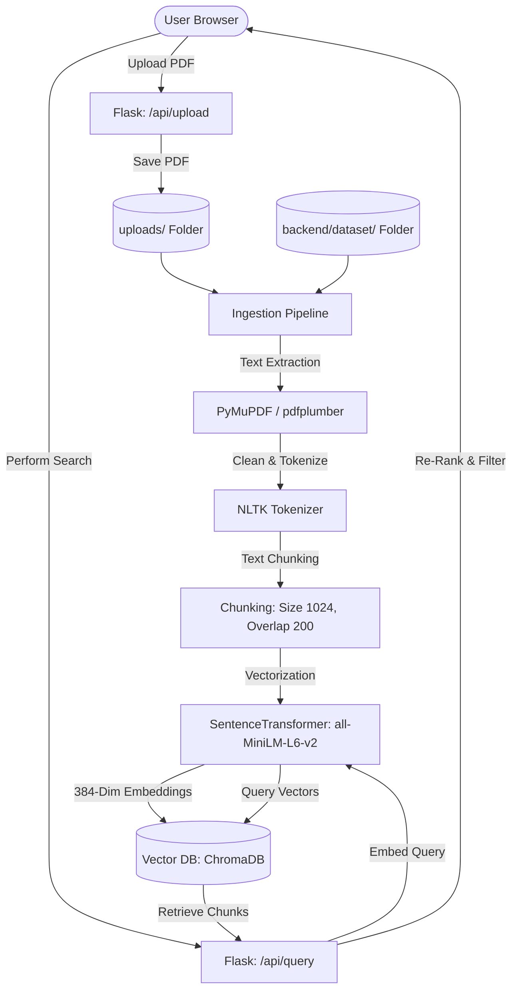

# RAG System — Machine Learning Document Search & Retrieval Engine

A high-performance, container-ready Retrieval-Augmented Generation (RAG) system for searching, indexing, and querying machine learning literature and PDFs. The system combines dense vector search with a premium, responsive glassmorphism web interface featuring light/dark themes, query history, diagnostics, and real-time query analytics.

---

## 🚀 Key Highlights & Architecture

The system uses a modular **Frontend-Backend** architecture designed for performance, modularity, and clean isolation of concerns.



### 🧠 Semantic Ingestion & RAG Pipeline
1. **Text Extraction**: Dual-engine parsing using **PyMuPDF (`fitz`)** as primary, falling back to **`pdfplumber`** for robust text and table extraction.
2. **Text Cleaning**: Sanitizes non-ASCII characters, removes excessive whitespace, and formats text streams.
3. **Sliding Window Chunking**: Tokenizes text using **NLTK's word tokenizers** into chunks of **1024 tokens** with a **200-token overlap** to preserve contextual semantic boundaries across boundaries.
4. **Dense Vector Embeddings**: Generates **384-dimensional** dense vector representations using the **`all-MiniLM-L6-v2`** Sentence Transformers model.
5. **Vector Storage**: Employs **ChromaDB** for high-speed similarity search, with a custom Numpy-backed `InMemoryCollection` fallback using cosine similarity if native database binaries are unavailable.

---

## 📁 Repository Structure

```text
RAG Project/
├── backend/              # Backend server, CLI tools & data modules
│   ├── app.py            # Main Flask Web API Application & Ingestion Engine
│   ├── run_rag.py        # CLI RAG pipeline testing & validation runner
│   ├── check_dataset.py  # Dataset integrity diagnostics & PDF checker
│   ├── setup.py          # Interactive automatic environment setup script
│   ├── requirements.txt  # Python dependencies
│   ├── database/         # Local database storage
│   │   └── users.db      # Users relational database sqlite
│   ├── dataset/          # Default document repository directory (PDFs go here)
│   └── venv/             # Local Python virtual environment (auto-created)
├── frontend/             # Single-Page Web Application assets
│   └── index.html        # Premium responsive web GUI (Glassmorphism layout)
├── uploads/              # Dynamic folder for runtime document uploads (auto-created)
└── data/                 # Dynamic folder for runtime search exports (auto-created)
```

---

## 📋 System Prerequisites

Ensure your host environment meets these baseline specifications:
- **Python**: version `3.8` to `3.14`
- **RAM**: 2GB minimum (4GB recommended for running larger model embeddings)
- **Disk Space**: ~1.5GB (includes model caches and NLTK library distributions)
- **Network**: Active connection for downloading models and packages on initial setup

---

## 🛠️ Installation & Setup

### Option 1: Automated Configuration (Recommended)
An interactive setup script is provided inside `backend/setup.py` that checks the host system compatibility, creates a localized python environment, upgrades `pip`, installs dependencies, and pulls required linguistic tokenizers automatically.

Run the script from your terminal:
```bash
python backend/setup.py
```

### Option 2: Manual Setup
If you prefer configuring files manually, perform these sequential commands:

```bash
# 1. Initialize the virtual environment inside backend/
python -m venv backend/venv

# 2. Activate the environment
# On Windows (PowerShell):
backend\venv\Scripts\activate
# On Linux/macOS:
source backend/venv/bin/activate

# 3. Upgrade pip package manager
python -m pip install --upgrade pip

# 4. Install requirements
pip install -r backend/requirements.txt

# 5. Download the required NLTK datasets
python -c "import nltk; nltk.download('punkt'); nltk.download('stopwords')"
```

---

## 🎯 Usage Instructions

### 1. Launching the Web Server
Activate the virtual environment and run the Flask application:

```bash
# Activation (if not active)
backend\venv\Scripts\activate

# Run backend
python backend/app.py
```
Open your browser and navigate to **`http://localhost:5000`** to access the web search interface.

### 2. Processing PDFs for Search
- Place PDF documents in the `backend/dataset/` directory.
- Click **"Process PDFs"** on the web interface to index all files into the vector database.
- Alternatively, use the **Drag & Drop** file uploader on the page to dynamically add and index PDFs at runtime.

### 3. Executing CLI Retrievals
You can run a mock retrieval pipeline and evaluate search similarity from the command line:
```bash
backend\venv\Scripts\python backend/run_rag.py --similarity-threshold 0.35 --top-k 3
```

---

## 📊 Complete API Documentation

| HTTP Method | Endpoint | Description | Request Payload | Response Schema |
|:---|:---|:---|:---|:---|
| **GET** | `/` | Serves main web application UI | None | HTML Page |
| **GET** | `/api/stats` | Returns document, chunk, and index metrics | None | `{"files": int, "chunks": int, "collection": str, "db_type": str}` |
| **POST** | `/api/process_pdfs` | Starts asynchronous backend PDF processing | `{"limit": int (optional)}` | `{"message": str, "status": "running"}` |
| **GET** | `/api/process_pdfs/status` | Gets current ingestion thread state | None | Ingestion status object |
| **POST** | `/api/process_pdfs/stop` | Terminates active document index task | None | `{"message": "Processing stopped by user"}` |
| **POST** | `/api/query` | Submits natural language search queries | `{"query": str, "top_k": int, "similarity_threshold": float}` | Results metadata array |
| **POST** | `/api/chat` | Interactive chat message with conversation memory | `{"message": str, "session_id": str}` | `{"response": str, "session_id": str}` |
| **GET** | `/api/chat/<session_id>` | Retrieves history of a chat session | None | `{"history": list}` |
| **GET** | `/api/pdf/list` | Lists all PDFs in dataset and upload folders | None | Lists of filenames |
| **POST** | `/api/pdf/remove` | Removes a specific PDF from system database | `{"filename": str}` | `{"message": "File removed successfully"}` |
| **POST** | `/api/pdf/remove_all` | Deletes all indexed PDFs and resets vector database | None | `{"message": "All database indexes removed"}` |
| **POST** | `/api/upload` | Uploads PDF files (Validates limit < 50MB) | Form-Data: `file` | `{"message": "Upload successful", "filename": str}` |
| **GET** | `/api/query_history` | Fetches historical queries list | None | Query history array |
| **DELETE** | `/api/query_history` | Clears search queries history log | None | `{"message": "History cleared"}` |
| **GET** | `/api/analytics` | Returns aggregated metrics & keyword counts | None | Analytics datasets object |
| **GET** | `/api/suggestions` | Generates query suggestions based on data history | None | `{"suggestions": list}` |
| **POST** | `/api/export` | Generates CSV or JSON data export downloads | `{"format": "csv" or "json", "results": list}` | File download download stream |
| **GET** | `/api/health` | Diagnostic system health check endpoint | None | `{"status": "healthy", "timestamp": str}` |

---

## 🔍 Dataset Diagnostics

Before processing PDFs, you can check your dataset for issues:

```bash
backend\venv\Scripts\python backend/check_dataset.py
```

- **Empty Files**: Flags PDFs with 0 bytes.
- **Corrupted Text Structure**: Flags files where text extraction yields empty arrays.
- **Oversized Documents**: Highlights files exceeding 100MB that could lead to Out-Of-Memory conditions.

---

## 🐛 Troubleshooting & Solutions

### 1. File Locks / OSError (WinError 32)
Occurs when virtual environments or model cache files are accessed simultaneously by other background run scripts.
- **Solution**: Kill any lingering python processes (`Stop-Process -Name python -Force` in PowerShell) and restart setup or server tasks.

### 2. Missing NLTK Tokenizers
If queries return exceptions complaining about missing resource folders (`tokenizers/punkt`):
- **Solution**: Manually force downloader execution in virtual environment:
  ```bash
  backend\venv\Scripts\python -c "import nltk; nltk.download('punkt', download_dir='backend/venv/share/nltk_data')"
  ```

### 3. Out-Of-Memory / Slow Embedding Performance
Generating embeddings on large files might consume heavy resources on systems without dedicated GPUs.
- **Solution**: Run diagnostics using `check_dataset.py` to identify and remove files exceeding 50-100MB, or adjust chunking settings in `backend/app.py`.
